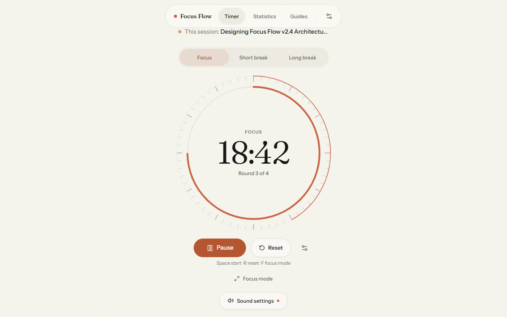
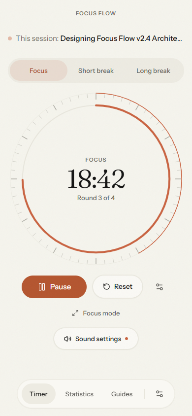

# Focus Flow

[](https://focusflow.ink)
[](LICENSE)

Focus Flow is a Pomodoro timer for web, PWA and desktop. It combines adjustable
focus sessions, ambient sound and a searchable history. It works offline without
an account; Google synchronization is optional.

## Features

- Focus, short-break and long-break intervals, with configurable rounds and goals.
- Task names, small checklists, keyboard controls and five visual themes.
- Rain, ocean recordings, generated noise, timer chimes and optional narration.
- Session history, statistics and exports to JSON, CSV, Markdown, iCalendar and PNG.
- Polish, English, Spanish and Simplified Chinese, including 27 practical guides
  with research references and clearly stated limits.
- Installable PWA with offline access. Desktop includes a tray, floating timer,
  system-browser Google login and local audio recordings.

Google sync shares completed history, settings and goals. Task names and
checklists are included by default and can be masked. Active timers and custom
audio files stay on each device. Pairing and macOS support remain experimental.

| Desktop | Mobile |
| --- | --- |
|  |  |

## Use and install

Open [focusflow.ink](https://focusflow.ink) or install the PWA from a compatible
browser. Desktop installers and checksums are available on the
[releases page](https://github.com/w3ziqv/focus-flow/releases).

Desktop installers are unsigned. Read [installation, backup and rollback](docs/INSTALL-UPDATE.md)
before updating. Preserve a JSON export and the native data directory. Earlier
alpha installers use a separate test cloud; their cloud history is not copied
automatically to production.

## Development

Requires Node.js 24 and npm. Desktop builds also require Rust and Tauri's native
system dependencies. Firebase configuration is optional; see `.env.example`.

```sh
npm ci
npm run dev
```

```sh
npm run typecheck
npm run lint
npm run test:run
npm run build
```

For desktop development use `npm run desktop:dev`; create installers with
`npm run desktop:build`. Ordinary CI desktop builds work offline. Production
cloud configuration must be provided through the protected release environment.
Never commit server credentials or private user data.

## Documentation

- [Roadmap](docs/ROADMAP.md)
- [Security and vulnerability reporting](SECURITY.md)
- [Data protection and trust boundaries](docs/SECURITY.md)
- [Installation, backup and rollback](docs/INSTALL-UPDATE.md)
- [Audio sources and licensing](public/sounds/SOUNDS.md)

## Author and license

Mateusz Szostak — [@w3ziqv](https://github.com/w3ziqv). MIT; see [LICENSE](LICENSE).
