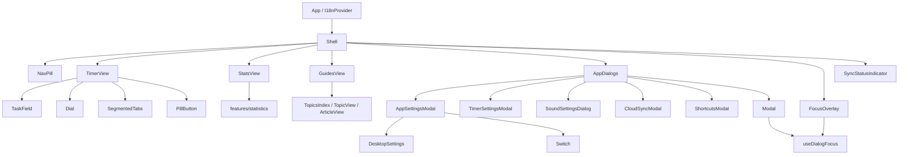
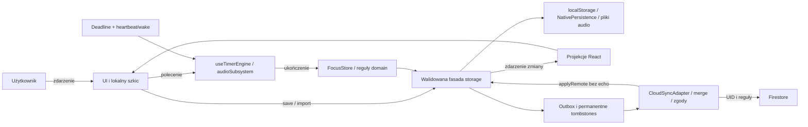

# Architektura UI Focus Flow

Stan kontraktu: 27.10.2026. Uzupełnia [ADR-0010](adr/0010-evidence-based-modular-modernization.md)
i [system designu](DESIGN.md). Mapa dotyczy rzeczywistego kodu, nie planowanego
przepisania silnika. Warunki publikacji pozostają w [rollout](PRODUCTION-ROLLOUT-3.0.md).

## Komponenty i zależności



`app/` jest korzeniem kompozycji: wybiera ekran, aktywuje funkcje i łączy ich
polecenia. `views/` składa ekran. `features/` grupuje elementy mające wspólny
model i zachowanie; nie wprowadza dodatkowego store. `ui/` dostarcza semantykę,
fokus i geometrię. Komponenty nie importują Shell. Adaptery nie importują UI.
Prymitywy mogą korzystać z `lib/i18n` jako wspólnego serwisu tekstu, ale nie
z persystencji, Firebase, IPC ani komponentów funkcji. ESLint rozwiązuje ścieżki
względne, również lazy importy, dzięki czemu zmiana głębokości `../` nie omija
granicy. Testy integracyjne mogą zestawiać różne warstwy.

```text
src/
  App.tsx                     wejście i provider języka
  app/                        Shell, AppDialogs, useDialogStack, nawigacja,
                              onboarding, instalacja PWA i granica błędów
  views/                      TimerView, StatsView, GuidesView i ekrany porad
  ui/                         PillButton, Switch, SegmentedTabs, Modal,
                              useDialogFocus, LoadingState oraz ich testy
  features/
    timer/                    Dial, TaskField, TimerSettingsModal, FocusOverlay,
                              useTimerFeedback; testy obok komponentów
    audio/                    SoundSettingsDialog, SoundChipRow, useAudioControls
    statistics/               wykresy, historia, filtry, eksport i milestones
    settings/                 AppSettingsModal, ShortcutsModal
    sync/                     CloudSyncModal, SyncStatusIndicator
    desktop/                  DesktopSettings, MiniDial
    guides/                   TipsAccordion
  domain/                     czyste reguły kalendarza i statystyk
  lib/                        istniejące adaptery timera, zapisu, audio, sync,
                              desktopu, i18n i treści; bez zależności od UI
  design/                     autorskie tokens.json, generowany tokens.css
```

Przeniesienia nadają właściciela istniejącym elementom i pozwalają egzekwować
kierunek importów. Ekrany i adaptery pozostają w swoich dotychczasowych warstwach.
Ustawienia mogą składać UI desktopu, a ekrany statystyk komponenty analityczne.
Nie łączymy tarczy z kołowym wykresem ani switcha z przyciskiem tylko ze względu
na podobny wygląd. Nie dodajemy biblioteki katalogu: kontrakty poniżej, testy
komponentów i zrzuty aplikacji pokrywają aktualną skalę bez dodatkowego runtime.

## Własność stanu

| Informacja | Właściciel / źródło prawdy | Trwałość | Subskrybenci / projekcje | Dozwolone zdarzenia |
| --- | --- | --- | --- | --- |
| Aktywna faza, deadline, running, runda | `useTimerEngine` i jego refs | snapshot ff2_session; native adapter na desktopie | TimerView, Dial, FocusOverlay, bridge, feedback | start/pause/reset/switch/complete/wake; chmura nie ustawia aktywnej fazy |
| Pozostały czas | wyliczenie z deadline | brak zapisu na tick | Dial i tekst timera | heartbeat/wake; heartbeat nie nalicza czasu jako suma ticków |
| Zadanie i checklista aktywnej fazy | engine | snapshot lokalny | TaskField i silnik ukończenia | setTask/add/toggle/remove; snapshot nie jest drugim silnikiem |
| Historia, dzienne sumy, cele | storage/FocusStore | ff2/ff3 lub native; opcjonalny outbox/cloud | engine.stats i StatsView jako odświeżane projekcje | complete/delete/edit/import/remote merge; tombstones pozostają trwałe |
| Filtry, limit 50, edytowany tekst historii | StatsView | pamięć zamontowanego ekranu | lista i agregaty pełnego zbioru | search/filter/show more/save/cancel; szkic nie modyfikuje historii przed save/blur |
| Głośność, tekstura, binaural i pliki | audioSubsystem | preferencje; pliki IndexedDB/native | `useAudioControls` jako snapshot, TimerView i dialog audio | polecenia subsystemu, import, remote preferences; audio nie jest stanem Dial |
| Motyw | Shell + lokalny zapis preferencji | lokalny | root CSS, ustawienia, eksport | onTheme/import; pięć motywów korzysta ze wspólnych ról |
| Język | I18nProvider | lokalny | wszystkie `useI18n`, także memo | setLang; zmiana context odświeża memo |
| Interfejs, skróty, maskowanie | fasada storage; Shell jako bieżąca projekcja | lokalny, wybrane ustawienia synchronizowane | Shell, dialogi, audio/narracja | patch/import/storage event; nie przechowywać niezależnych autorytatywnych kopii |
| Otwarte dialogi | useDialogStack w Shell | pamięć | AppDialogs; manager fokusu wyprowadza najwyższą warstwę DOM | push bez duplikatów/pop; rodzic pozostaje zamontowany |
| Szkic długości i celu, skrótów/webhooka | odpowiedni dialog | pamięć instancji, dopiero Save zapisuje | lokalny formularz | edit/save/cancel; resize ani tick nie resetuje szkicu |
| Ekran / trasa porad | Shell / GuidesView | pamięć | NavPill / ekrany porad | navigate/topic/article/back; opuszczenie porad resetuje trasę |
| Tożsamość, zgoda, stan sync i błędy | CloudSyncAdapter | storage jako cache; tokeny native w OS | CloudSyncModal i SyncStatusIndicator | login/logout/consent/sync/retry/online/offline; UI nie nadaje uprawnień UID |
| Onboarding i sugestia instalacji | app + fasada preferencji | lokalne flagi | onboarding/InstallPrompt | done/dismiss/install; bez przejęcia aktywnego timera |
| Tray/mini, pending settings, błędy zapisu | desktop bridge / native runtime | odpowiednie ustawienia i pliki | Shell, MiniDial, DesktopSettings | IPC i allowlisted commands; WebView nie dostaje refresh tokenu |



Cache stanu sync nie jest dowodem zalogowania; adapter odtwarza Auth i weryfikuje
projekt/UID/epokę. `engine.stats` i lista historii są projekcjami utrwalonych
danych, a nie niezależnymi właścicielami. Przepływ nie zapewnia transakcji wielu
kluczy w web ani formalnego exactly-once. Granice z modelu zagrożeń pozostają:
plik/peer → walidator, Auth/UID → reguły, WebView → ograniczone IPC → Rust.

## Interakcje systemowe

Nawigacja zmienia ekran, zachowując engine w Shell. Statystyki i porady nie
otrzymują czasu pozostałego. `AppDialogs` jest memoizowane i otrzymuje stabilne
polecenia oraz konkretne preferencje. Zmiana danych, języka, audio lub ustawień
nadal aktualizuje odpowiednie komponenty; nie używamy własnego komparatora,
który pomijałby propsy.

Stos app → shortcuts/cloud zachowuje szkic rodzica. Tylko najwyższy dialog
obsługuje Escape/Tab; pozostała strona jest inert. `useDialogFocus` przelicza
inertność z aktualnego stosu, odtwarza pierwotny stan elementów oraz overflow
body. Obsługuje również usunięcie rodzica przed dzieckiem i lazy placeholder.
Po zamknięciu wraca do przycisku otwierającego; gdy ten zniknął, do rodzica lub
aktywnego przycisku nawigacji. Loading dialog ma nazwę i działające zamknięcie.

Globalne skróty nie działają wewnątrz modalnego UI, pól tekstowych, podczas IME
ani z Ctrl/Alt/Meta. Space na przycisku pozostaje natywną aktywacją. Fokus mode
jest modalnym UI i ma własne przyciski timera. Escape w poradach cofa jeden poziom.
SegmentedTabs stosuje roving tabindex, strzałki z zawijaniem i Home/End.
Resize nie zmienia kluczy komponentów ani stanu formularza/fazy. Zoom jest
dozwolony; 320 px, dotyk i 200% są oddzielnymi scenariuszami weryfikacji.

## Rozwijanie UI

1. Określ właściciela danych, szkic i zdarzenie zapisu przed dodaniem stanu.
2. Dodaj element do istniejącej funkcji albo `ui/`, gdy semantyka i zachowanie
   są współdzielone. Nowy ekran należy do `views/`, aktywacja funkcji do `app/`.
3. Nowy wspólny token edytuj w JSON i wygeneruj CSS. Nie kopiuj koloru motywu.
4. Każdy dialog opieraj na Modal/useDialogFocus; dodaj go do stosu. Nie dodawaj
   kolejnego niezależnego handlera Escape, który zamyka rodzica.
5. Sprawdź loading/empty/error/disabled/offline tylko tam, gdzie mają znaczenie.
   Pokazuj lokalizowany błąd; nie renderuj surowego wyjątku ani danych jako HTML.
6. Mierz przed optymalizacją. `measure:ui` liczy wykonane fibers w commitach
   React DevTools, w dev ze stabilnymi nazwami; nie jest benchmarkiem produkcyjnego
   CPU, baterii ani pamięci. Produkcyjne pomiary mają osobne skrypty.
7. Uruchom lint, typecheck, testy odpowiedzialności i scenariusz użytkownika.
   Kontrakty przykładów: [UI-COMPONENTS.md](UI-COMPONENTS.md).
