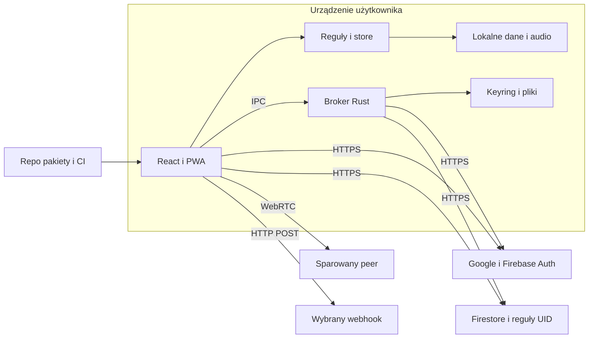

## Executive summary

Focus Flow jest aplikacją osobistą z lokalną persystencją, opcjonalną chmurą
oraz natywnym brokerem uprawnień. Najważniejsze granice to UID/projekt Firebase,
niezaufany import i peer oraz WebView → Rust. Testy nie wykazały dostępu między
kontami w regułach źródłowych. Potwierdzono i poprawiono utratę specjalnego ID
w outbox. Największa otwarta rozbieżność to starsza konfiguracja produkcyjna:
brak części reguł v3 i nagłówków ochronnych. Nie wdrażano produkcji.

## Scope and assumptions

Zakres: `src/`, `src-tauri/`, konfiguracja Vite/PWA/Vercel, reguły Firestore,
zależności i CI. Kod vendored GLib oceniany przez istniejące dokumenty/lockfile;
nie przeprowadzono ponownego pełnego audytu biblioteki systemowej.

Właściciel potwierdził 26.10.2026: aplikacja osobista bez zespołów, potencjalnie
prywatne opisy zadań, opcjonalny Firebase oraz świadomie używane urządzenia
desktop/P2P. To nie jest model organizacyjnego systemu wielodzierżawnego z RBAC.
Odczyt konfiguracji usług jest w zakresie; zmiany produkcji i interaktywne
logowanie na konto użytkownika nie są. Nie odczytywano dokumentów z historią.

Otwarte pytania zmieniające ryzyko: rzeczywista wrażliwość wpisów użytkowników,
stan aktualizacji systemowych WebView i polityka podpisywania instalatorów.
Nie zakładamy ich potwierdzenia przez testy browserowe. Nowych testów Rust i
fizycznego uśpienia nie wykonano lokalnie; toolchain Rust jest niedostępny.

## System model

### Primary components

- UI React i PWA: `App.tsx`, `views/`, `components/`, `vite.config.ts`.
- Czyste reguły i adaptery: `domain/`, `lib/store.ts`, `storage.ts`,
  `desktop/runtime.ts`; stan timera jest niezależny od chmury.
- Audio/backup: `audio.ts`, `audioSubsystem.ts`, `soundStore.ts`, `dataPort.ts`.
- Chmura: `sync/adapter.ts`, `firebase.ts`, `nativeFirebase.ts`, reguły UID.
- Native: `src-tauri/src/lib.rs`, `cloud.rs`, `storage.rs`, capabilities.
- Peer/webhook: `desktop/peer.ts`, `crdt.ts`, `replica.ts`, `webhook.ts`.
- Budowanie/CI: package/Cargo lockfiles, `.github/workflows/`, `verify-builds.mjs`.

### Data flows and trust boundaries

- Użytkownik/plik → UI → walidatory: JSON i audio przez File API; limit bajtów,
  schema, blokada kluczy prototypu (`dataPort.ts:184–212`, `soundStore.ts`).
  Dane nie są renderowane jako HTML. Granica pozostaje niezaufana po parsowaniu.
- UI → lokalny adapter: typowane ustawienia i historia przez synchroniczną
  fasadę `storage.ts`; web używa localStorage/IndexedDB, desktop kolejki snapshotów
  i IPC. Dane pozostają czytelne dla posiadacza konta systemowego.
- UI → Google/Firebase: OAuth/HTTPS; odtworzenie Auth i epoka konta przed
  użyciem UID (`adapter.ts:884–915`), consent/kopia przy zmianie właściciela.
  Firestore egzekwuje UID, limity i walidację. Własne algorytmy merge/outbox
  odpowiadają za zgodność domenową; cache SDK sam jej nie zapewnia.
- WebView → Rust: typowane komendy IPC, permissions dla main/mini oraz ponowna
  kontrola `window.label()` (`lib.rs:138–163`, capabilities). Rust jest zaufany
  i ma uprawnienia procesu; nie jest ograniczany przez webowy CSP.
- Rust → Google/Firebase/keyring/pliki: stałe hosty HTTPS, brak redirectów,
  OAuth state i S256 PKCE (`cloud.rs:97–98,191–276`); tokeny poza JS, prywatne
  atomowe snapshoty i backupy (`src-tauri/src/storage.rs`).
- Urządzenie → świadomie sparowany peer: WebRTC z fingerprintem, bez STUN/relay,
  tylko host candidates; ramki/rozmiar/timeout i walidacja CRDT
  (`peer.ts:4–24,74`, `crdt.ts`). Peer może dostarczyć nieuczciwą treść.
- UI → wskazany webhook: HTTP POST, bez cookies/referrera/redirectów, 5 s timeout
  (`webhook.ts:14–20,67–88`). Jawnie udostępnia treść zadań. Obecny CSP blokuje
  arbitralne zewnętrzne hosty; nie dodano nowego transportu Rust ani proxy.
- Repo/pakiety → CI → artefakt: lockfiles, przypięte Actions, uprawnienia read,
  testy i kontrola źródeł przy ponownym użyciu instalatora. To odrębna granica
  od runtime; `npm audit` nie obejmuje całego toolchainu systemowego.

#### Diagram

## Assets and security objectives

| Asset | Why it matters | Security objective (C/I/A) |
| --- | --- | --- |
| Zadania, checklisty, historia | Ujawniają prywatne czynności i czas pracy | C/I/A |
| UID/projekt i refresh tokens | Określają właściciela zdalnych danych | C/I |
| Outbox i tombstones | Utrzymują edycje/delecje po offline | I/A |
| Lokalne snapshoty i backup | Jedyna kopia dla użytkownika offline | C/I/A |
| Uprawnienia main/mini | Chronią pliki, cloud i operacje systemowe | C/I |
| Kod i instalatory | Użytkownik wykonuje je z własnymi prawami | I |

## Attacker model

### Capabilities

Napastnik może hostować stronę/archiwum, nakłonić do importu lub parowania,
posiadać własne konto Google, edytować własne dokumenty Firestore przez SDK
oraz otworzyć aplikację publiczną. Złośliwy peer może wysyłać niepoprawne dane.
Ataki na dev tooling wymagają osiągalnego serwera lub odpowiedniego wejścia;
nie przenosimy automatycznie ich severity do produkcyjnego statycznego JS.

### Non-capabilities

Bez dodatkowego przełamania napastnik nie posiada tokenu ofiary, dostępu do jej
procesu/pliku/keyringu, możliwości zmiany wdrożonych reguł ani podpisania
zaufanego artefaktu. Posiadacz konta systemowego może czytać lokalny plaintext;
to silniejszy model niż anonimowy użytkownik Internetu. CSP i UID nie chronią
przed przejętym zaufanym core Rust lub skompromitowanym pakietem buildowym.

## Entry points and attack surfaces

| Surface | How reached | Trust boundary | Notes | Evidence |
| --- | --- | --- | --- | --- |
| Import JSON/audio | Użytkownik wybiera plik | Plik → aplikacja | Limity bajtów, schema, audio probe | `dataPort.ts:184`, `soundStore.ts` |
| Auth i cloud | Opcjonalne połączenie Google | Konto/projekt → dane | Auth restoration, epoka, UID w regułach | `adapter.ts:884`, `firestore.rules` |
| Callback OAuth | Lokalny listener | Przeglądarka systemowa → Rust | Jednorazowy state/PKCE | `cloud.rs:191–276` |
| Komendy IPC | JS w main lub mini | WebView → proces OS | Permissions i runtime guards | `lib.rs:138–163`, capabilities |
| Peer | Jawne offer/answer | Obce urządzenie → lokalne dane | Fingerprint/host candidates/2 MiB | `peer.ts:4–24,74` |
| Webhook | Włączona konfiguracja | Dane → wybrany odbiorca | Bez credentials/redirectów, ograniczony CSP | `webhook.ts:67–88` |
| Dokument i chunks | Nawigacja/PWA | Host/CI → kod aplikacji | Meta CSP, bounded chunk recovery | `index.html:5`, `chunkRecovery.ts` |
| Dev tooling/CI | npm, workflow, serwer dev | Pakiety/repo → wykonywany kod | Audit, pinned Actions, loopback emulator | lockfiles, workflows |

## Top abuse paths

1. Cudze dane: własne konto → żądanie `users/ofiara` → próba odczytu/zapisu.
   Reguły UID odrzucają oba działania; emulator potwierdza izolację.
2. Utrata oczekującej sesji: złośliwy import z ID `__proto__` → zapis do zwykłego
   obiektu outbox → wpis nie trafia do JSON. Potwierdzone przed zmianą, naprawione
   słownikiem bez prototypu; nie jest to potwierdzone RCE/globalne pollution.
3. Mieszanie kont: zmiana konta podczas żądania → stara odpowiedź → próba zapisu
   pod nową tożsamością. Epoki/UID i potwierdzenie zmiany właściciela blokują
   znane ścieżki; istnieją regresje w `sync_adversarial.test.ts`.
4. Podszyte parowanie: obcy offer/answer → akceptacja przez użytkownika → próba
   wysłania ogromnych ramek lub niepoprawnych pól. Limity/timeout/CRDT odrzucają
   wejście, ale świadome parowanie nadal udostępnia dane drugiemu urządzeniu.
5. Clickjacking: obca strona osadza produkcję → użytkownik klika ukryte akcje.
   Brak serwerowych nagłówków blokady ramki jest potwierdzony; wykonalności
   całego ataku nie testowano. Źródłowy `frame-ancestors 'none'` czeka na rollout.
6. Niedopasowanie wersji: klient v3 → starsze produkcyjne reguły → odmowa
   `daily_history` albo brak pełnego egzekwowania maskowania/delecji.
   To potwierdzona rozbieżność konfiguracji, nie dowód przełamania UID.
7. Utrata własnych danych: quota/przerwanie wielu zapisów → różne rewizje
   historii/liczników/kolejki → niepełne odtworzenie. Native ma atomowe pliki;
   browserowy localStorage nie jest transakcją. Kopie ograniczają skutki.

## Threat model table

| Threat ID | Threat source | Prerequisites | Threat action | Impact | Impacted assets | Existing controls (evidence) | Gaps | Recommended mitigations | Detection ideas | Likelihood | Impact severity | Priority |
| --- | --- | --- | --- | --- | --- | --- | --- | --- | --- | --- | --- | --- |
| TM-001 | Użytkownik innego konta | Własny token | Cudzy UID w ścieżce | Ujawnienie/zmiana historii | Historia | UID/default deny, 56 prób (`firestore.rules`) | Brak wykazanego bypassu | Zachować testy create/update/list/delete | Emulator i allowlisted permission-denied | low: brak ścieżki obejścia | high: cudza prywatna historia | low |
| TM-002 | Niezaufany import | Ofiara importuje archiwum | Specjalne ID w outbox | Pominięcie oczekującej sesji | Outbox | Walidacja i nowy null-prototype (`outbox.ts:11`) | Naprawione; quota nadal odrębna | Utrzymać regresję serializacji | Test `outbox.test.ts` | low: wymaga konkretnego importu | low: własny wpis, bez obcych danych | low |
| TM-003 | Stary transport/tożsamość | Zmiana konta podczas async | Zastosowanie starej odpowiedzi | Pomieszanie profili | Historia i tożsamość | Epoka/UID/backup (`adapter.ts:295,884–915`) | Realne OAuth/keyring częściowo nieweryfikowane | Test dwóch fizycznych kont i revocation | Kody błędów bez tokenów | low: guards istnieją | high: prywatność profili | low |
| TM-004 | Złośliwy peer | Świadome parowanie | Niepoprawne ramki/archiwum | Zatrzymanie sync lub zła treść | Dostępność/integralność | Fingerprint, limity, CRDT (`peer.ts`, `crdt.ts`) | Parowanie nie potwierdza uczciwości peer-a | Utrzymać adversarial tests i granice wersji | Kontrolowany error/timeout | low: nie jest otwartym endpointem | medium: lokalna historia | low |
| TM-005 | Obca strona | Możliwość osadzenia strony | Podsunięte akcje | Niechciane zmiany konta/danych | UI i historia | Meta CSP; konfiguracja headers w repo | Nagłówki nieobecne na produkcji | Osobny rollout headers i test ramek | Kontrola obu domen po deploy | medium: nagłówków brak, exploit niezweryfikowany | medium: wymaga interakcji | medium |
| TM-006 | Rozbieżny deployment | Klient v3, stare reguły | Zapis poza kontraktem | Niedziałające daily history / prywatność | Cloud i tombstones | UID nadal egzekwowany; projekt testowy zgodny | Potwierdzony starszy ruleset produkcji | Kontrolowany rollout z kopią i porównaniem migracji | Hash odczytanego rulesetu | high: stan zaobserwowany | medium: własne dane, nie cross-user | medium |
| TM-007 | Quota/awaria lokalna | Przerwanie zapisu lub dwie karty | Niespójne klucze | Utrata/podwójne zliczenie | Lokalne dane | Deadline, stałe ID, kopie; native atomic file | Brak transakcji web i formalnego exactly-once | Osobny prototyp journaling/IDB po pomiarze | Fault-injection na adapterze i porównanie kopii | medium: możliwe awarie | medium: lokalna historia | medium |
| TM-008 | Pakiet/build tooling | Osiągalne podatne wejście | Wykorzystanie advisory | Wykonanie w dev/utrata dostępności | Kod, maszyna build | Naprawiony lockfile, audit, pinned Actions | Audyt npm nie obejmuje OS/Rust/tool CLI | Zachować cykliczne kontrole i cargo audit w CI | Audit workflow | low po patchach; warunkowa ekspozycja | high dla przejętego build | low |

## Criticality calibration

- **critical**: zdalne wykonanie w core Rust bez zgody; anonimowy odczyt wszystkich
  kont. Żadnego takiego przypadku nie potwierdzono.
- **high**: możliwy odczyt cudzego profilu po Auth; kradzież refresh tokenu przez
  nieuprzywilejowany WebView. Brak wykazanej ścieżki w badanym kodzie.
- **medium**: brak kontraktu maskowania/daily history we wdrożeniu; nieodwracalna
  utrata historii po częściowym zapisie. Wpływ dotyczy własnych danych/operacji.
- **low**: pominięcie specjalnego ID w świadomym imporcie; odrzucenie niepoprawnej
  ramki świadomie sparowanego peer-a. Nie równa się eskalacji konta.

Priorytety są oparte na osobistym, dobrowolnym modelu produktu. Wspólne stacje
firmowe lub dane regulowane zwiększyłyby wagę cache/at-rest i wymagań operacyjnych.

## Focus paths for security review

| Path | Why it matters | Related Threat IDs |
| --- | --- | --- |
| `src/lib/sync/adapter.ts` | UID/projekt, consent, epoki i retry | TM-001, TM-003, TM-006 |
| `src/lib/sync/firestore.rules` | Serwerowa autoryzacja i walidacja | TM-001, TM-006 |
| `src/lib/sync/outbox.ts` | Trwałe oczekujące zmiany i granice remote | TM-002, TM-007 |
| `src/lib/dataPort.ts` | Niezaufany JSON/audio i limity | TM-002, TM-007 |
| `src/lib/desktop/peer.ts`, `crdt.ts` | Granica obcego urządzenia | TM-004 |
| `src-tauri/src/cloud.rs`, `lib.rs` | Tokeny, OAuth i IPC | TM-003, TM-004 |
| `src-tauri/src/storage.rs`, `desktop/persistence.ts` | Odtwarzanie i awaria zapisu | TM-007 |
| `index.html`, `vercel.json` | CSP/ramki/zgodność wdrożenia | TM-005 |
| `.github/workflows/`, lockfiles | Zaufany build i zależności | TM-008 |

## Notes on use

Objęto odkryte wejścia, każdą granicę z modelu, runtime oraz odrębne CI/dev.
Założenia potwierdzono z właścicielem przed raportem. Oddzielono poprawione
błędy, istniejące kontrole, ryzyka warunkowe i potwierdzone rozbieżności usług.
Zmiany produkcji, fizyczny desktop, screen reader, revocation/keyring i nowe
kontrole Cargo wymagają osobnej weryfikacji. Pełne wyniki i źródła:
[raport bezpieczeństwa](SECURITY_REPORT_2026-10-26.md).
